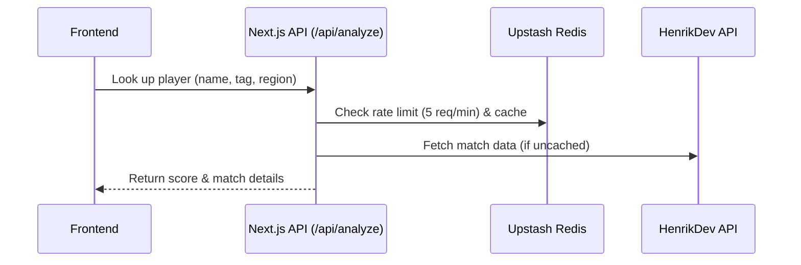

# CypherScan

A lightweight Valorant match history analyzer and smurf heuristic tool.

[](https://nextjs.org/)
[](https://www.typescriptlang.org/)
[](https://tailwindcss.com/)
[](https://vitest.dev/)
[](https://upstash.com/)
[](https://github.com/features/actions)

---

## What is CypherScan?

CypherScan lets you look up a Valorant player's recent competitive matches and calculates a heuristic score (0–100) to see if their performance patterns resemble an alternate or smurf account.

---

## Scoring Breakdown

The score weighs four signals across recent competitive games:

- **Lobby ACS Deviation (40%)**: Compares the player's ACS against the average of the other 9 players in the lobby to check for outperformance relative to the match.
- **MVP Consistency (25%)**: Tracks how often the player gets Match MVP (1.0x) or Team MVP (0.5x).
- **Account Level Factor (20%)**: Low-level accounts (< 25 or 40) that heavily outperform get flagged, while low-level accounts performing normally are pardoned. Accounts over level 100 are treated as likely main accounts.
- **Rust Factor (15%)**: Flags accounts returning after an inactivity gap (> 7 days) and immediately putting up high ACS (> 250).

> **Note:** This is an experimental heuristic based on public match history, not an official verdict or anti-cheat check.

---

## How It Works

Next.js server route handlers (`/api/analyze`) query HenrikDev's unofficial Valorant API so secret API keys remain safe on the server. Upstash Redis handles caching and rate limiting.



- **Rate Limiting**: 5 requests/minute per IP via `@upstash/ratelimit`.
- **Caching**: 10-minute cache in Upstash Redis to conserve external API quota.
- **Validation**: Payload validation with Zod.

---

## Tech Stack

- **Framework**: Next.js (App Router) & TypeScript
- **Styling**: Tailwind CSS v4 + Shadcn UI
- **Cache / Rate Limit**: Upstash Redis
- **Testing**: Vitest
- **External API**: HenrikDev Unofficial Valorant API
- **CI / Hosting**: GitHub Actions & Vercel

---

## Getting Started

### Prerequisites
- Node.js 20+ (Node 22 recommended)
- HenrikDev API key ([Dashboard](https://api.henrikdev.xyz/dashboard/))
- Upstash Redis database ([Upstash Console](https://console.upstash.com/))

### 1. Setup

```bash
git clone https://github.com/asperavl/cypherscan.git
cd cypherscan
npm install
```

### 2. Environment Variables

Create `.env.local` based on `.env.example`:

```bash
HENRIK_API_KEY=your_henrik_key
UPSTASH_REDIS_REST_URL=your_upstash_url
UPSTASH_REDIS_REST_TOKEN=your_upstash_token
```

### 3. Run

```bash
# Start dev server (http://localhost:3000)
npm run dev

# Run tests
npm test

# Run tests in watch mode
npm run test:watch
```

---

## License

This project is licensed under the MIT License - see [LICENSE](LICENSE) for details.
